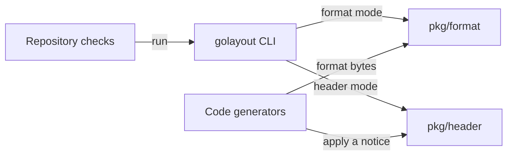

# golayout

[English](README.md) | [简体中文](README.zh_CN.md) | [Online manual](https://longxi-go.github.io/golayout/)

golayout formats Go source with structural layout rules and gofumpt. Its CLI and
in-memory libraries let repositories and code generators apply the same policy.
A separate header operation maintains source notices from a template you supply.

Requires **Go 1.27.0 or later**. Pin a golayout version to keep source checks and
generated output reproducible; review rule and API changes when upgrading.



## Install and use

Install the CLI and check explicit files:

```sh
go install github.com/longxi-go/golayout/cmd/golayout@v0.1.4
golayout -lang go1.27 file.go
golayout -w -lang go1.27 file.go
```

The default mode is read-only and reports paths with differences. Differences or
invalid input produce a nonzero exit status; `-w` writes changes. Add the
installation directory to `PATH`.

To pin the CLI as a Go module tool instead, run inside your module:

```sh
go get -tool github.com/longxi-go/golayout/cmd/golayout@v0.1.4
go tool golayout -lang go1.27 file.go
```

Generators use `github.com/longxi-go/golayout/pkg/format`:

```sh
go get github.com/longxi-go/golayout/pkg/format@v0.1.4
```

```go
formatted, err := format.Source(source, format.Options{
    LangVersion: "go1.27",
})
```

`source` is a byte slice and is left unchanged. Handle `err` before validating or
writing the result. Derive `LangVersion` from the target module's `go.mod`.
The [quick start](docs/design/docs/quick-start.md) includes a complete program.

## Formatting rules

- Expand nonempty function bodies, struct and interface declarations, and
  control-flow blocks into multiple lines.
- Separate top-level declarations and grouped type declarations with blank lines.
- Expand named, generic and inferred composite literals, including one-element
  literals. Explicit map, slice and array literals expand when their values
  include composite or function literals; simple scalar collections follow gofumpt.
- Keep canonical empty forms such as `struct{}`, `interface{}`, `select {}`
  and empty functions compact.

Rules operate on syntax without loading packages or resolving types. A named
literal is treated consistently whether its underlying type is a struct, map or
slice. The formatter does not choose package boundaries, split files or wrap
arbitrary expressions.
See the [architecture](docs/design/docs/architecture.md) for API and write semantics.

## Source notices

Create a plain-text `codequality/HEADER` with your copyright owner and license
notice, then check or update files:

```sh
golayout -header codequality/HEADER file.go
golayout -w -header codequality/HEADER file.go
```

Header mode preserves generated markers, build constraints, package documentation
and the code body. It rejects replacement of a different copyright owner and
does not format code. Run header and formatting operations separately.

Generators can call `pkg/header.Source` before formatting and validating output.
The caller selects and loads the template, chooses files and owns persistence;
golayout does not decide copyright ownership or year policy.
See the [header API contract](docs/design/docs/architecture.md#in-memory-apis)
for supported notice forms and refresh limitations.

## Documentation and contributing

- [Quick start](docs/design/docs/quick-start.md): CLI and library examples.
- [Integration guide](docs/integration.md): repository gates and generator adoption.
- [Architecture](docs/design/docs/architecture.md): rules, API boundaries and failures.
- [Development guide](docs/design/docs/development.md): contributor setup and quality gates.
- [Documentation maintenance](docs/design/README.md): build and preview the bilingual manual.
- [Roadmap](docs/roadmap.md): capabilities and policy evolution.
- [GitHub Releases](https://github.com/longxi-go/golayout/releases): version history.
