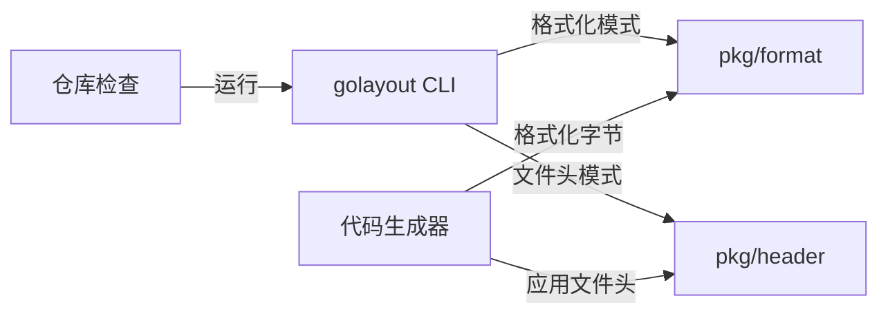

# golayout

[English](README.md) | [简体中文](README.zh_CN.md) | [在线手册](https://longxi-go.github.io/golayout/zh/)

golayout 结合结构布局规则与 gofumpt 格式化 Go 源码，仓库和代码生成器通过 CLI
及内存 API 使用同一套策略。独立的文件头操作根据调用方提供的模板维护源码声明。

要求 **Go 1.27.0 或更高版本**。固定 golayout 版本可复现源码检查和生成结果；
升级时需审查规则与 API 的变化。



## 安装与使用

安装 CLI，检查显式指定的文件：

```sh
go install github.com/longxi-go/golayout/cmd/golayout@v0.1.4
golayout -lang go1.27 file.go
golayout -w -lang go1.27 file.go
```

默认只读检查并报告存在差异的文件路径。存在差异或输入无效时返回非零退出状态；
`-w` 才写入修改。安装目录需要加入 `PATH`。

也可以在模块内将 CLI 固定为 Go 模块工具：

```sh
go get -tool github.com/longxi-go/golayout/cmd/golayout@v0.1.4
go tool golayout -lang go1.27 file.go
```

生成器使用 `github.com/longxi-go/golayout/pkg/format`：

```sh
go get github.com/longxi-go/golayout/pkg/format@v0.1.4
```

```go
formatted, err := format.Source(source, format.Options{
    LangVersion: "go1.27",
})
```

`source` 为字节切片，调用不会修改其内容。处理 `err` 后再验证或写出结果。
`LangVersion` 应从目标模块的 `go.mod` 推导。
完整程序见[快速开始](docs/design/docs/quick-start.zh.md)。

## 格式规则

- 将非空函数体、结构体和接口声明、控制流代码块展开为多行。
- 使用空行分隔顶层声明和分组中的类型声明。
- 展开命名类型、泛型及省略类型的复合字面量，包括单元素字面量。
  显式 map、slice 和 array 字面量的值包含复合字面量或函数字面量时展开；简单标量集合遵循 gofumpt。
- `struct{}`、`interface{}`、`select {}` 和空函数等规范的空形式保留紧凑布局。

规则仅处理语法，不加载包或解析类型。无论底层类型是 struct、map 还是 slice，
命名复合字面量均采用一致的处理方式。格式化器不划分包边界、拆分文件或对任意表达式换行。
API 与写入语义见[架构说明](docs/design/docs/architecture.zh.md)。

## 源码文件头

创建纯文本文件 `codequality/HEADER`，写入项目的版权主体和许可证声明，然后检查或更新文件：

```sh
golayout -header codequality/HEADER file.go
golayout -w -header codequality/HEADER file.go
```

文件头模式保留生成标记、构建约束、包注释和代码体，拒绝覆盖其他版权主体的声明，
且不格式化代码。文件头处理与格式化应分别执行。

生成器可在格式化和验证输出之前调用 `pkg/header.Source`。
模板选择与读取、文件选择及保存结果由调用方负责；golayout 不决定版权归属或年份策略。
支持的声明形式和刷新限制见[文件头 API 约定](docs/design/docs/architecture.zh.md#in-memory-apis)。

## 文档与贡献

- [快速开始](docs/design/docs/quick-start.zh.md)：CLI 与库的使用示例。
- [接入指南](docs/integration.zh.md)：仓库检查与生成器接入。
- [架构说明](docs/design/docs/architecture.zh.md)：规则、API 边界及失败行为。
- [开发指南](docs/design/docs/development.zh.md)：贡献者环境配置与质量检查。
- [文档维护](docs/design/README.zh.md)：构建与预览双语手册。
- [路线图](docs/roadmap.zh.md)：能力与策略演进。
- [GitHub Releases](https://github.com/longxi-go/golayout/releases)：版本历史。
