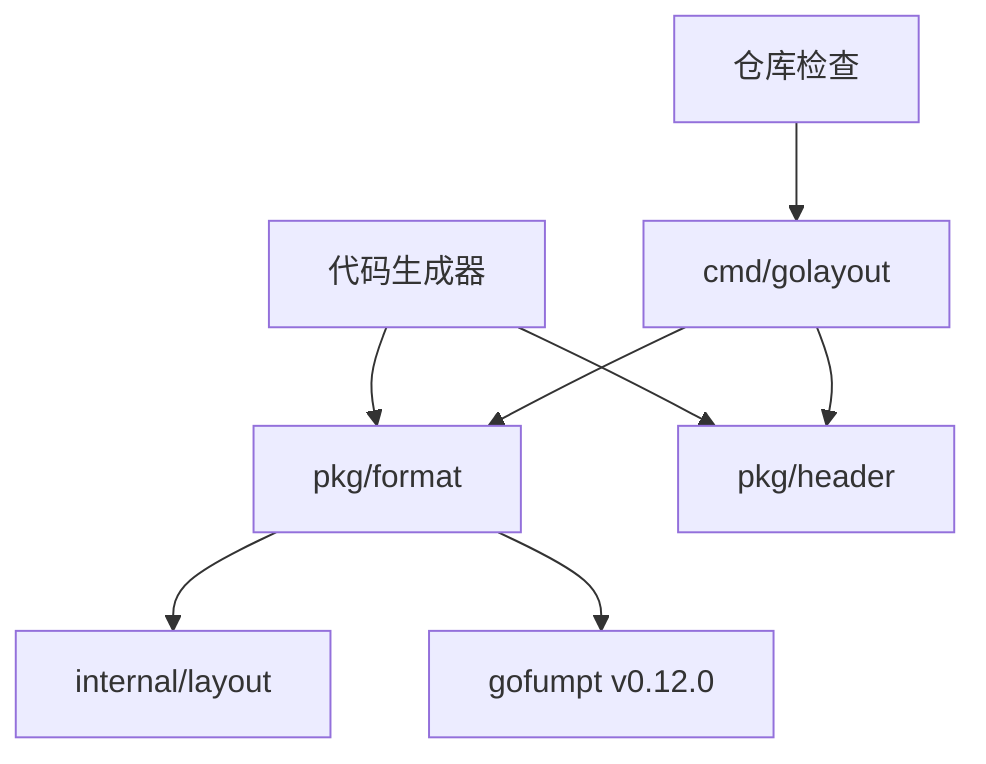

# golayout

[English](README.md) | [简体中文](README.zh_CN.md) | [在线手册](https://longxi-go.github.io/golayout/zh/)

golayout 为 Go 仓库和代码生成器提供统一的源码格式化与文件头工具。
`pkg/format` 结合 AST 布局规则与 gofumpt v0.12.0；`pkg/header` 负责更新文件头声明，
与格式化分开执行。
两个 API 均不加载应用包。

要求 **Go 1.27.0 或更高版本**。当前模块尚未达到 v1，后续版本可能调整 API 或格式规则；
应固定依赖版本，以便复现检查结果。

箭头表示入口对 API 的调用关系。文件头处理与格式化分别执行。



## 安装与使用

安装 CLI，检查显式指定的文件：

```sh
go install github.com/longxi-go/golayout/cmd/golayout@v0.1.3
golayout -lang go1.27 file.go
golayout -w -lang go1.27 file.go
```

默认模式只读。存在格式差异或输入无效时，命令以非零状态退出；`-w` 才写入修改。
安装目录需要加入 `PATH`。

也可以将 CLI 固定为 Go 模块工具：

```sh
go get -tool github.com/longxi-go/golayout/cmd/golayout@v0.1.3
go tool golayout -lang go1.27 file.go
```

生成器通过 `go get` 添加 `github.com/longxi-go/golayout/pkg/format@v0.1.3`，
然后调用内存 API：

```go
formatted, err := format.Source(source, format.Options{
    LangVersion: "go1.27",
})
```

其中 `source` 为字节切片。处理 `err` 后再验证或写出结果。
`LangVersion` 应从目标模块的 `go.mod` 推导，此处仅以 `go1.27` 为例。
完整程序见[快速开始](docs/design/docs/quick-start.zh.md)。

## 格式规则

- 将非空函数体、结构体和接口声明、控制流代码块展开为多行。
- 分隔顶层声明和分组中的类型声明。
- 展开命名类型及省略类型的复合字面量，不解析其实际类型。
  显式 map、slice 和 array 字面量的值包含复合字面量或函数字面量时展开；简单标量集合遵循 gofumpt。
- 允许 `struct{}`、`interface{}`、`select {}` 和空函数等规范的单行形式。

格式化不负责决定包边界、拆分文件，也不能替代全部可读性审查。
具体范围见[架构说明](docs/design/docs/architecture.zh.md)。

## 源码文件头

`codequality/HEADER` 保存项目维护的 Go 文件所需的纯文本文件头声明：

```sh
golayout -header codequality/HEADER file.go
golayout -w -header codequality/HEADER file.go
```

文件头模式保留生成标记、构建约束、包注释和代码体，拒绝覆盖其他版权主体的声明，
且不格式化代码。文件头处理与格式化应分别执行。

生成器可选定模板并调用 `pkg/header.Source`，然后格式化并验证输出。
文件发现、模板读取和文件所有权由调用方负责。

## 开发

golayout 可以独立克隆和测试，不需要工作区或同级模块。
安装[开发依赖](docs/design/docs/development.zh.md#quality-gates)后运行：

```sh
make setup
make license-headers format
GOWORK=off make check
make docs-build
```

仓库检查选择 Git 已跟踪文件和符合条件的未跟踪源码，排除 `.tmp`、`.cache`、vendor 文件和符号链接。
格式化还包括完整的 `testdata/**/*.go.tmpl` 样本；文件头刷新排除 testdata。
使用方配置见[接入指南](docs/integration.zh.md)。

## 版本发布

Git tag 定义模块版本；`go.mod` 中的 `go` 指令定义最低 Go 版本。
分支推送和 Pull Request 运行 Quality。`v*` tag 触发 Release：校验稳定版本 `vX.Y.Z`
及对应版本说明，检查该 tag 的源码，发布 GitHub Release，然后部署该版本文档。
已发布 tag 不得移动或复用。

[GitHub Releases](https://github.com/longxi-go/golayout/releases) 提供版本历史。
每个版本的英文说明保存在 [`docs/releases`](docs/releases)，
[发布指南](docs/design/docs/development.zh.md#releases)说明具体流程。

## 文档

- [English manual](https://longxi-go.github.io/golayout/)
- [简体中文手册](https://longxi-go.github.io/golayout/zh/)
- [站点维护](docs/design/README.zh.md)
- [路线图](docs/roadmap.zh.md)

运行 `make docs-serve` 可在本地预览文档。CI 会构建分支中的修改；
稳定版本发布并部署后，Pages 才会更新。
