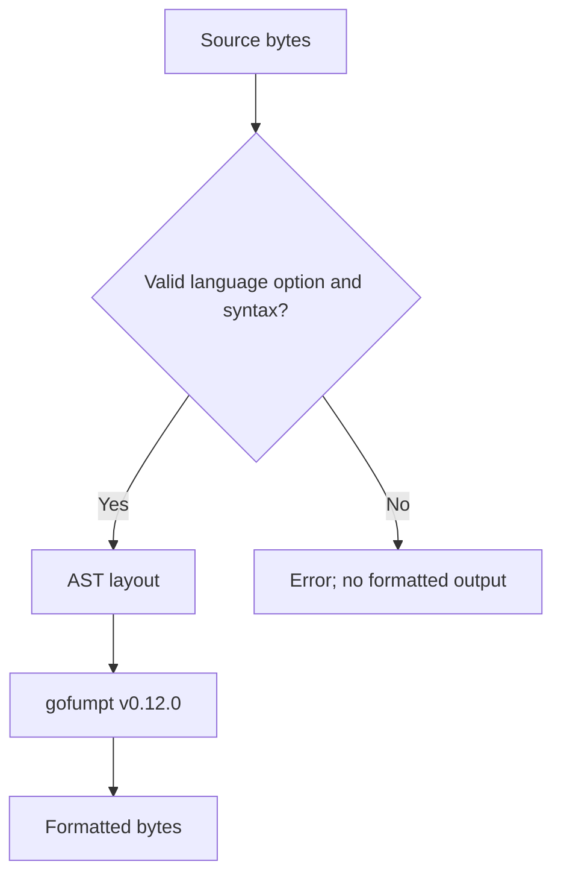
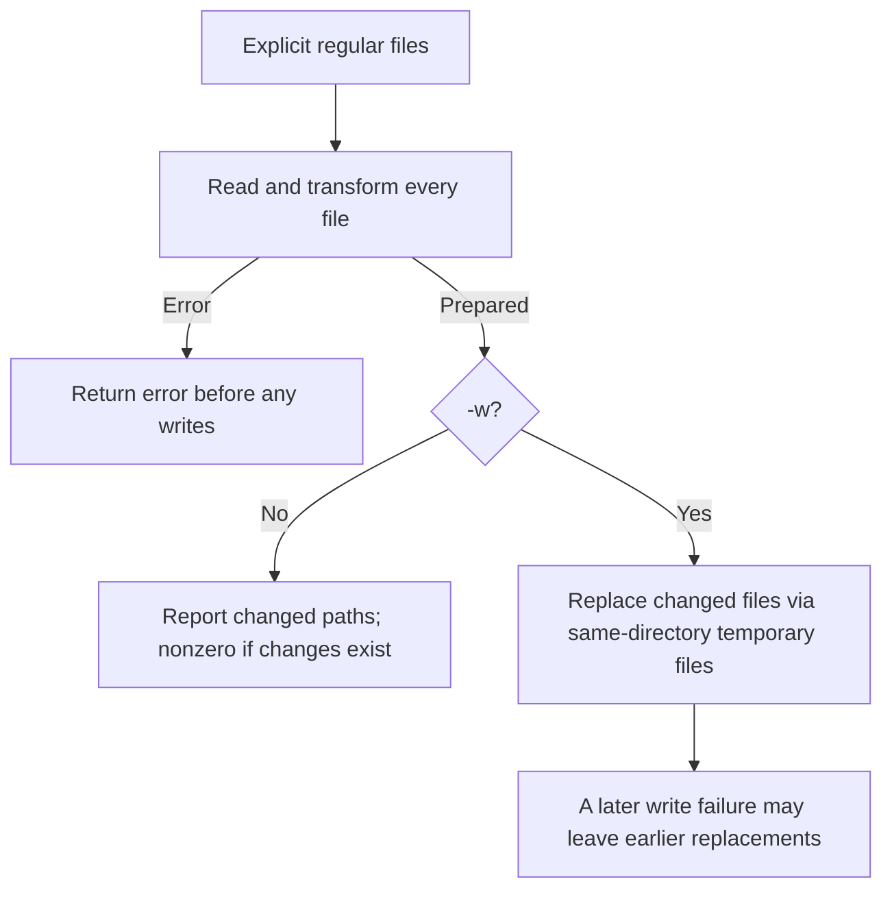

# Architecture

## In-memory APIs

`pkg/format.Source` validates the optional language version, applies AST layout
rules and then runs gofumpt v0.12.0. It does not load application packages or
resolve types. Calls are independent and leave input bytes unchanged. Invalid
syntax returns an error without formatted output.

`pkg/header.Source` applies an explicit plain-text notice independently of
formatting. It preserves the code body, package documentation, build constraints
and generated markers, and rejects replacing another copyright owner. It does
not infer a template, owner or year policy. Template selection and optional
loading belong to the caller.

## Formatting rules

| Syntax | Policy |
| --- | --- |
| Nonempty function and method bodies | Multiline |
| Nonempty struct and interface declarations | One field declaration or interface element per line |
| Nonempty control-flow blocks | Multiline, through Go formatting |
| Top-level declarations and grouped type declarations | Separated by blank lines |
| Named, generic or inferred composite literals | Multiline, including one-element literals |
| Explicit map, slice and array literals | Multiline when values include composite or function literals |
| Simple scalar collections and empty forms | Follow canonical Go formatting |

Without type loading, a named composite literal cannot be reliably classified
as a struct, map or slice. The syntax rule therefore treats these literals
consistently. Empty forms such as `struct{}`, `interface{}`, `select {}` and empty
functions may remain on one line. No artificial statements or comments are added.

Formatting is deterministic and idempotent. Package boundaries, file splitting
and discretionary line wrapping remain design and review responsibilities.

## CLI and file writes

`cmd/golayout` delegates to `internal/command`. The command validates and transforms
all requested files before writing any. Read-only mode reports changed paths and
returns a nonzero status. Write mode replaces each file through a temporary file
in the same directory and preserves its permission bits.

Replacement is per-file, not a transaction across the entire batch. The CLI
rejects non-regular files, including symlinks. File discovery and ownership checks
remain outside the in-memory APIs.

## Repository integration

Shared scripts select Git-tracked and eligible untracked source. They exclude
`.tmp`, `.cache`, vendor files and symlinks. Formatting includes complete,
parseable `testdata/**/*.go.tmpl` fixtures; header refreshes exclude all testdata.
Ordinary test inputs and production generator templates are not auto-formatted.

Generators call `pkg/header` when a notice is required, then `pkg/format`, followed
by their own validation and output steps. Repository gates use the same version
through the CLI. Consumers must not copy private rules or formatter implementations.

## Dependency direction

golayout depends on pinned gofumpt and its dependencies, not on gosr, ioc, nemo or
application source. `pkg/format` composes the private layout implementation;
`pkg/header` is independent of formatting. The command combines file operations
with these public APIs.

Editor gofumpt settings cover only the upstream formatter. Use the golayout gate
to check the complete structural policy.
