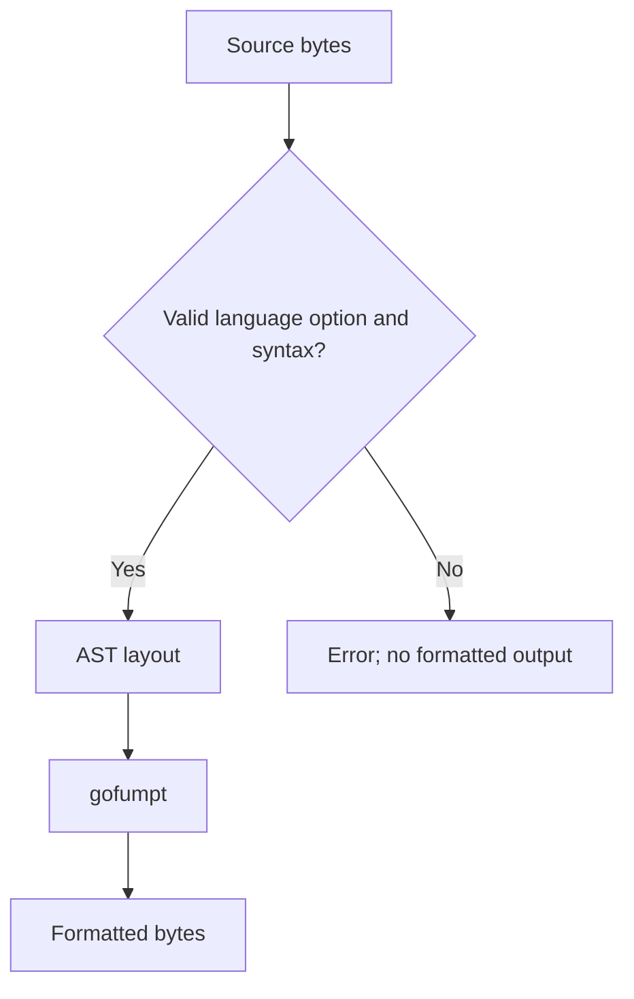
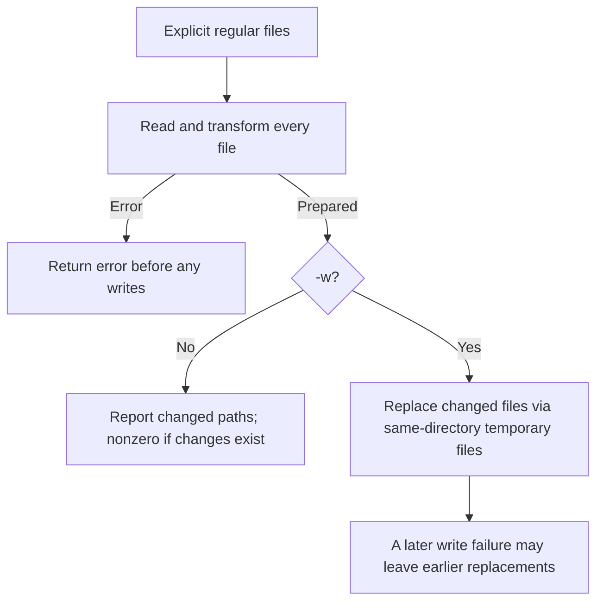
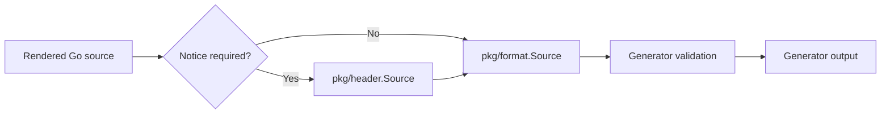
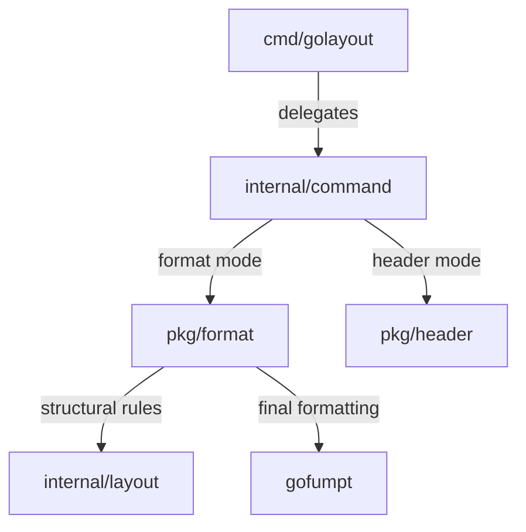

# Architecture

## In-memory APIs

`pkg/format.Source(input, options)` applies AST layout rules and then gofumpt.
`Options.LangVersion` selects the target Go language version, such as `go1.27`;
an empty value uses the formatter's default. An invalid version or invalid syntax
returns an error without formatted output. Formatting does not load packages,
resolve types or replace the generator's own type validation.

`pkg/header.Source(source, notice)` applies an explicit plain-text notice
independently of formatting. It preserves the code body, package documentation,
build constraints and generated markers, and rejects replacing another copyright
owner. It does not infer a template, owner or year policy. Template selection and optional
loading belong to the caller. Both APIs leave input bytes unchanged and have no
filesystem effects; calls are independent.

A header template must be UTF-8 text without NUL bytes and begin with a plain-text
copyright line. Supported year forms include `2026`, `2026-2027` and
`2026-present`. For example, `Copyright © 2026 the example authors.` identifies
the owner; subsequent lines supply the license notice.
Do not include `//` or `/* */` around the template. The library adds Go line
comments. Invalid Go, an unsupported copyright line, a different recognized
owner, an incomplete Apache line-comment notice or multiple generated markers
returns an error without output. Incomplete Apache line-comment notices are
rejected rather than guessing where their license text ends.

Existing line-comment notices are recognized as a copyright line alone, a
copyright line followed by an SPDX identifier, or a complete Apache notice.
Other license text is retained as surrounding comments and can be duplicated on
repeated updates. Use a supported form for repeatable header refreshes.

## Formatting rules

| Syntax | Policy |
| --- | --- |
| Nonempty function and method bodies | Multiline |
| Nonempty struct and interface declarations | One field declaration or interface element per line |
| Nonempty control-flow blocks | Multiline, through Go formatting |
| Top-level declarations and grouped type declarations | Separated by blank lines |
| Named, generic or inferred composite literals | Multiline, including one-element literals |
| Explicit map, slice and array literals | Multiline when values include composite or function literals |
| Simple scalar collections and empty forms | Follow canonical Go formatting |

Without type loading, a named composite literal cannot be reliably classified
as a struct, map or slice. The syntax rule therefore treats these literals
consistently. Empty forms such as `struct{}`, `interface{}`, `select {}` and empty
functions may remain on one line. No artificial statements or comments are added.

Formatting is deterministic and idempotent. Package boundaries, file splitting
and discretionary line wrapping remain design and review responsibilities.

## CLI and file writes

`cmd/golayout` delegates to `internal/command`. The command validates and transforms
all requested files before writing any. Read-only mode reports changed paths and
returns a nonzero status. Write mode replaces each file through a temporary file
in the same directory and preserves its permission bits.

Replacement is per-file, not a transaction across the entire batch. The CLI
rejects non-regular files, including symlinks. File discovery and ownership checks
remain outside the in-memory APIs.

## Repository integration

Each step must succeed before its output is used by the next. The generator
selects the target language and template, validates the formatted output and
controls persistence. Neither library executes input code.

Repository gates use the same golayout version through the CLI. Keep file
selection outside the libraries and reuse the shared implementation rather than
copying private rules. The [development guide](development.md#source-selection)
describes the repository scripts' selection policy.

## Dependency direction

`pkg/header` is independent of formatting. `pkg/format` composes private layout
rules with the gofumpt dependency pinned in `go.mod`; gofumpt's optional `-extra`
rules are disabled. Application modules are not dependencies of either API.

Editor gofumpt settings cover only the upstream formatter. Use the golayout gate
to check the complete structural policy.
