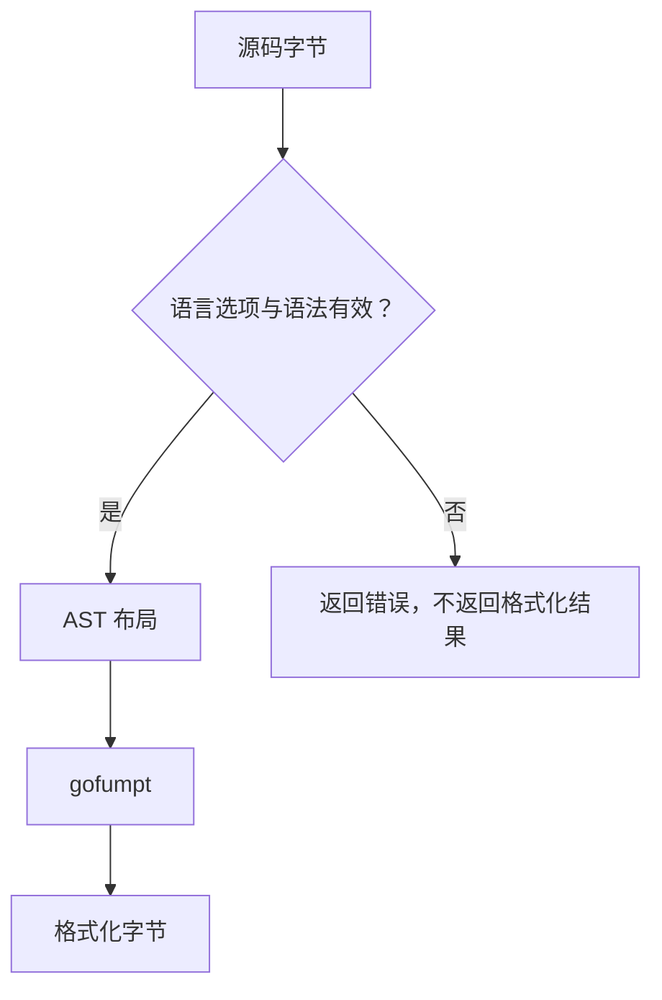
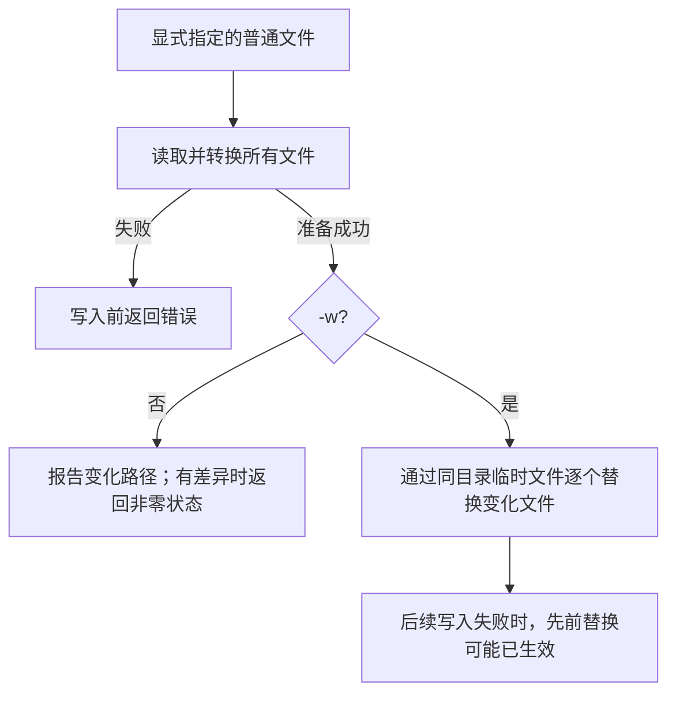
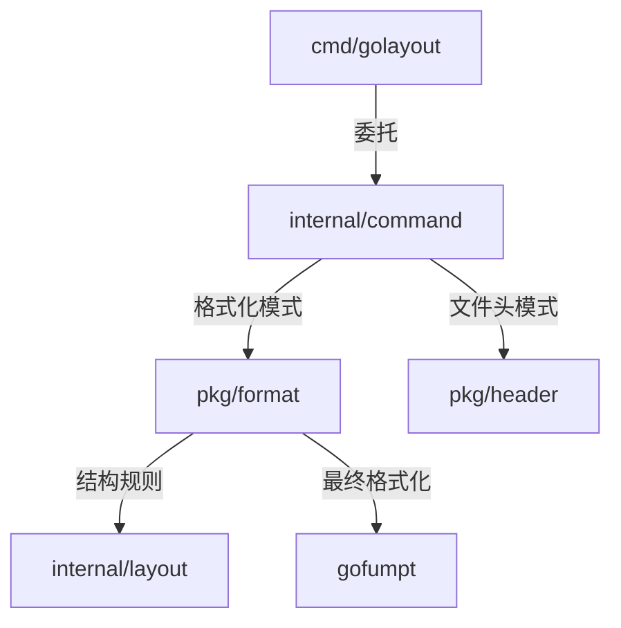

# 架构

## 内存 API

`pkg/format.Source(input, options)` 应用 AST 布局规则后，再调用 gofumpt。
`Options.LangVersion` 指定目标 Go 语言版本，例如 `go1.27`；空值使用格式化器的默认行为。
语言版本或语法无效时返回错误，不返回格式化结果。格式化不加载包或解析类型，
生成器仍需自行执行类型验证。

`pkg/header.Source(source, notice)` 使用调用方传入的纯文本文件头模板，与格式化分开执行。
它保留代码体、包注释、构建约束和生成标记，拒绝覆盖其他版权主体的声明，
也不推断模板、版权主体或年份策略。是否读取模板、使用哪份模板，由调用方决定。
两个 API 均不修改输入字节，不访问文件系统，各次调用彼此独立。

文件头模板必须是无 NUL 字节的 UTF-8 文本，第一行为纯文本版权行。
支持的年份形式包括 `2026`、`2026-2027` 和 `2026-present`。
例如，`Copyright © 2026 the example authors.` 标识版权主体，后续行提供许可证声明。
不要在模板外加 `//` 或 `/* */` 注释标记，库会添加 Go 行注释。
Go 语法无效、版权行不受支持、识别到其他版权主体、Apache 行注释声明不完整或存在多个生成标记时，
返回错误且不返回结果。Apache 行注释声明不完整时直接拒绝处理，不会猜测许可证文本的结束位置。

已有的行注释文件头支持三种形式：单独的版权行、版权行后接 SPDX 标识符、完整的 Apache 声明。
其他许可证正文会作为周边注释保留，反复更新可能产生重复文本。需要反复刷新文件头时，
应使用上述支持的形式。

## 格式规则

| 语法 | 策略 |
| --- | --- |
| 非空函数体和方法体 | 多行 |
| 非空结构体和接口声明 | 每个字段声明或接口元素独占一行 |
| 非空控制流代码块 | 由 Go 格式化展开为多行 |
| 顶层声明和分组中的类型声明 | 使用空行分隔 |
| 命名类型、泛型或省略类型的复合字面量 | 展开为多行，包括单元素字面量 |
| 显式 map、slice 和 array 字面量 | 值包含复合字面量或函数字面量时展开 |
| 简单标量集合和空形式 | 遵循 Go 规范格式 |

不加载类型时，无法可靠判断命名复合字面量的底层类型是 struct、map 还是 slice，
因此采用一致的语法规则。`struct{}`、`interface{}`、`select {}` 和空函数等空形式允许保留单行。
格式化不会为了展开空形式而添加语句或注释。

格式化具有确定性和幂等性。包边界、文件拆分和逻辑换行仍需人工审查。

## CLI 与文件写入

`cmd/golayout` 调用 `internal/command` 处理命令。命令先完成所有指定文件的校验和转换，
再开始写入。
只读模式报告有变化的路径，并返回非零状态。写入模式通过同目录临时文件逐个替换源文件，
保留文件权限位。

每个文件单独替换，不提供整个批次的事务。CLI 拒绝符号链接等非普通文件。
文件发现和所有权检查不属于内存 API 的职责。

## 仓库接入

每一步成功后才能将结果交给下一步。生成器选择目标语言和模板，验证格式化后的结果并负责保存。
两个库均不执行输入代码。

仓库检查通过 CLI 使用同一个 golayout 版本。文件选择位于库之外，应复用共享实现，
避免复制私有规则。仓库脚本的选择策略见[开发指南](development.md#source-selection)。

## 依赖方向

`pkg/header` 独立于格式化。`pkg/format` 组合私有布局规则与 `go.mod` 固定的 gofumpt 依赖，
gofumpt 可选的 `-extra` 规则未启用。两个 API 均不依赖应用模块。

编辑器启用 gofumpt 后，仅应用 gofumpt 自身的规则；完整的结构布局规则仍需通过 golayout 检查。
