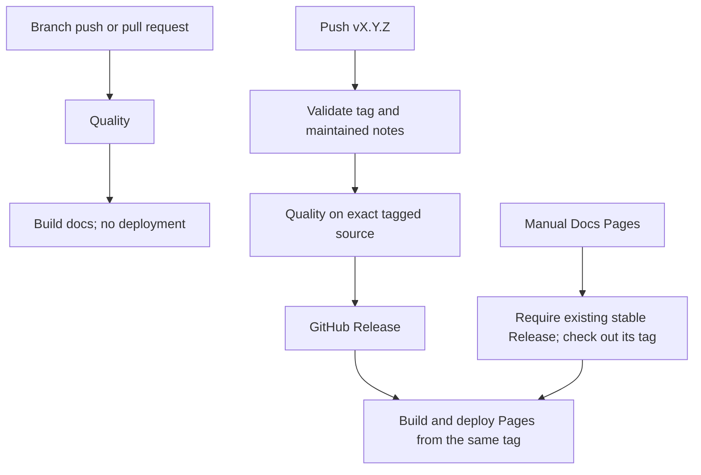

# Development

## Quality gates

Development requires Git, Bash, Make and Go. The CI matrix checks compatibility
with Go 1.27.0 and runs the full quality gate with Go 1.27.4.
Install the linter version used by `.github/workflows/quality.yml`:

```sh
go install github.com/golangci/golangci-lint/v2/cmd/golangci-lint@v2.15.0
```

Ensure `golangci-lint` is on `PATH`, or set `GOLANGCI_LINT` to its executable.
From the repository root:

```sh
make setup
make license-headers format
GOWORK=off make check
```

`setup` resolves formatter dependencies without installing a binary or modifying
module files. `license-headers` and `format` write owned source. `check` is the
read-only gate for source notices, layout, module tidiness, vet, unit tests with
coverage, shuffled race tests, lint and tooling tests. It may populate tool caches.
Use `make help` for individual targets.

## Local workspace

golayout has no dependency on other ecosystem repositories and can be tested
alone. For local work on a consumer, create a workspace in their parent directory:

```sh
go work init ./golayout ./consumer
```

Replace `./consumer` with the actual path. Use `go work use` to extend an existing
workspace. Nested modules, such as a separate tools module, must be included
explicitly. Keep `go.work` and `go.work.sum` local; production `go.mod` files must
not contain developer-specific directory replacements.

Run checks inside each module. A workspace build does not verify that a consumer's
declared dependency versions resolve independently; use `GOWORK=off` for that check.

## Documentation

The site requires Python 3.12 and uv. From the repository root:

```sh
make docs-setup
make docs-serve
make docs-build
```

`docs-build` uses locked dependencies and strict validation. Preview the English
site at `http://127.0.0.1:8000/golayout/` and Chinese at `/golayout/zh/`.
Site sources are under `docs/design/docs`. Add both `page.md` and `page.zh.md`,
and update both navigation trees in `mkdocs.yml`. Keep generated HTML and the
virtual environment untracked.

Before committing documentation, review both languages against the implementation.
Check prerequisites, command context, API behavior, limitations, versions and links.
A successful build validates rendering; technical accuracy and translation still
require review.

## Releases



Git tags define module versions. The `go.mod` `go` directive defines the minimum
Go version; the documentation project's version does not control module releases.
Each release has English notes in `docs/releases/vX.Y.Z.md`, starting with
`# golayout vX.Y.Z` and a nonempty body. README describes usage and the release
process; the notes and GitHub Releases record version history.

1. Add the version's notes and update installation examples in both languages.
2. Review the complete diff, including documentation accuracy and language parity.
3. Run `GOWORK=off make check docs-build validate-release TAG=vX.Y.Z` with the
   intended version substituted for `vX.Y.Z`.
4. Commit and push the reviewed files. Wait for Quality to pass on that commit.
5. Create an annotated tag on that exact commit, using the message
   `Release golayout vX.Y.Z`, then push the tag.
6. Verify the Release workflow, published notes and deployed Pages content.

A pushed `v*` tag starts Release. Validation accepts stable `vX.Y.Z` versions
without leading zeroes, prerelease suffixes or build metadata. v2 and later
require a versioned module path and a release-policy update. Current v0.x
releases may introduce intentional API or formatting changes.

Release checks the tagged source through reusable Quality, publishes the GitHub
Release, then deploys documentation from the same tag. Go module proxies can
resolve a tag as soon as it is pushed, independently of the GitHub Release.
Published tags must not be moved or reused. On workflow failure, rerun the failed
jobs after resolving the cause; do not overwrite an existing release.

## Pages publishing

Pages serves the [English manual](https://longxi-go.github.io/golayout/) and
[Chinese manual](https://longxi-go.github.io/golayout/zh/). Branch pushes and pull
requests build documentation without deployment. Release deploys a stable
version after publishing its GitHub Release.

Manual Docs Pages runs require the `release_tag` of an existing, published stable
release. The workflow checks out that tag. For automatic deployment, the
`github-pages` environment must allow `v*` tags; a manual run from `main` also
requires that branch to be allowed. Pages uses GitHub Actions as its source.

The publishing job has Pages and OIDC permissions. Quality has read-only
repository permissions. Release calls Docs Pages directly rather than relying
on a second event from `GITHUB_TOKEN`.

Deployed builds obtain their base URL from `configure-pages`. Override
`DOCS_SITE_URL` with a trailing slash for a custom domain or preview path.

Material requests the latest stable Release, Star count and Fork count from
GitHub in the browser. The release label describes repository activity; it does
not identify the source version of this page. The repository link remains usable
when those requests fail.
