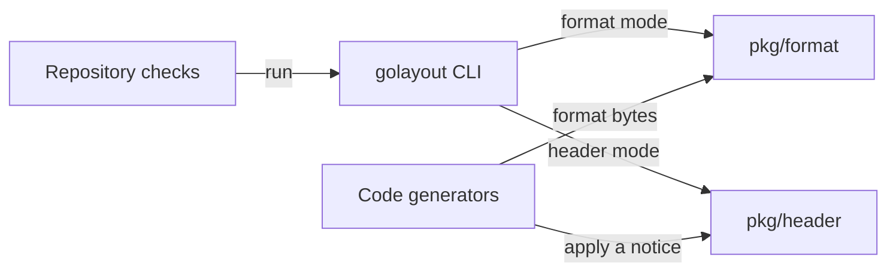

# Go formatting and source notices

**golayout** gives Go repositories and code generators the same source-formatting
policy through a CLI and in-memory APIs. It requires Go 1.27.0 or later.

[Get started](quick-start.md){ .md-button .md-button--primary }
[Formatting rules and contracts](architecture.md){ .md-button }

| Use case | Entry point |
| --- | --- |
| Check or rewrite explicit source files | `golayout [-w] -lang go1.27 file.go` |
| Format generated source in memory | `pkg/format.Source` |
| Check or refresh notices from your template | `golayout [-w] -header codequality/HEADER file.go` |
| Apply a notice before formatting generated code | `pkg/header.Source` |

Nonempty function bodies, struct and interface declarations, and control-flow
blocks use multiple lines. Empty forms may remain compact. Composite literal
rules depend on syntax and do not load packages or resolve types.
See [formatting rules](architecture.md#formatting-rules) for the full policy.

Header handling is separate from formatting. You supply the template and retain
control of file selection, copyright ownership and persistence. Generators apply
an optional notice, format, then perform their own validation and output steps.

Pin the same golayout version for repository checks and generated output. Review
rule and API changes when upgrading. Contributor workflows are in the
[development guide](development.md).
