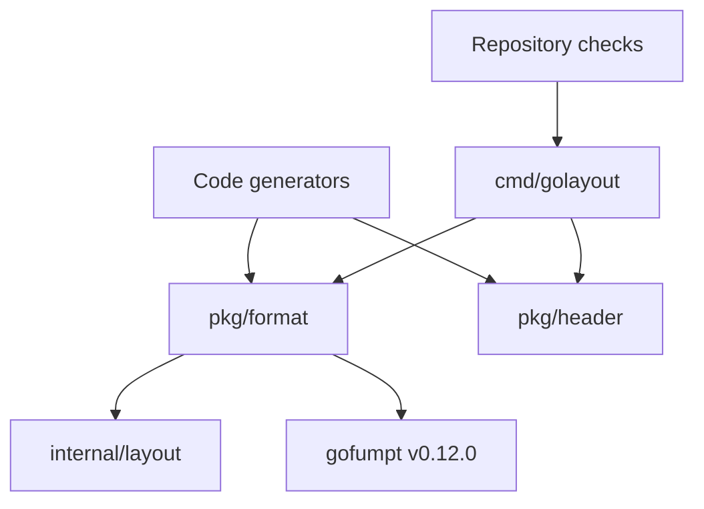

# Go formatting and source notices

**golayout** provides a shared formatting library, a source-notice library and a
CLI for Go repositories and code generators. It requires Go 1.27.0 or later.

[Get started](quick-start.md){ .md-button .md-button--primary }
[Read the architecture](architecture.md){ .md-button }

Arrows show calls to shared APIs; header and format modes are separate.

| Component | Responsibility |
| --- | --- |
| `pkg/format` | Format source bytes using AST layout rules and gofumpt v0.12.0 |
| `pkg/header` | Apply an explicit source-notice template without formatting code |
| `internal/layout` | Implement structural rules without loading application types |
| `internal/command` | Validate explicit files, report differences and write replacements |
| `cmd/golayout` | Provide the CLI entry point |
| Repository scripts | Select owned files and apply repository exclusions |

Nonempty function bodies, struct and interface declarations, and control-flow
blocks use multiple lines. Empty forms may remain compact. Composite literal
rules depend on syntax; see [formatting rules](architecture.md#formatting-rules).
File boundaries and manual line wrapping remain design and review decisions.

Generators call the public libraries; repository gates use the CLI and shared
scripts. Pin the same golayout version for both paths. The module works
independently of gosr, ioc and nemo.
