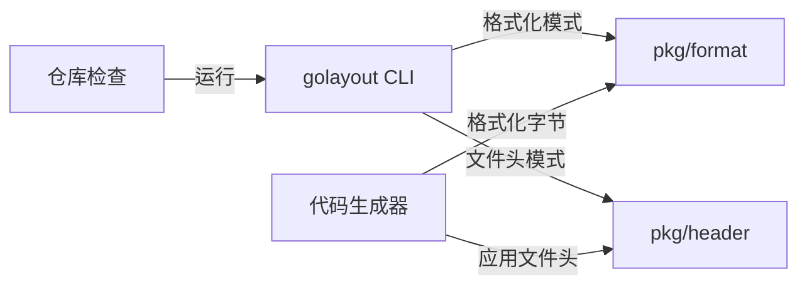

# Go 格式化与源码文件头

**golayout** 通过 CLI 与内存 API，让 Go 仓库和代码生成器使用同一套源码格式化策略。
要求 Go 1.27.0 或更高版本。

[开始使用](quick-start.md){ .md-button .md-button--primary }
[格式规则与使用约定](architecture.md){ .md-button }

| 用途 | 入口 |
| --- | --- |
| 检查或重写显式指定的源码文件 | `golayout [-w] -lang go1.27 file.go` |
| 在内存中格式化生成代码 | `pkg/format.Source` |
| 根据项目模板检查或刷新文件头 | `golayout [-w] -header codequality/HEADER file.go` |
| 在格式化生成代码前应用文件头 | `pkg/header.Source` |

非空函数体、结构体和接口声明、控制流代码块采用多行布局；空形式可以保留紧凑布局。
复合字面量按语法分类处理，不加载包或解析类型。完整策略见[格式规则](architecture.md#formatting-rules)。

文件头处理独立于格式化。调用方提供模板，负责文件选择、版权归属和结果保存。
生成器按需应用文件头，完成格式化后执行自身的验证与输出步骤。

仓库检查和生成代码应固定同一个 golayout 版本，升级时需审查规则与 API 的变化。
贡献者工作流程见[开发指南](development.md)。
